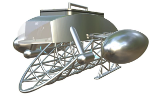

  
  <h1>🌟 Marine Collection Vessel</h1>
  
<strong>A catamaran-style boat with versatile collection systems for multi-purpose.</strong>

## 📖 Overview

- 🚤 **Marine Collection Vessel:** Vessel used to collect various floating items.
- 🎮 **Remote Controller:** Compact and ergonomic handheld remote with joysticks, buttons and display.

## ✨ Key Features

- 📡 **Real-time wireless communication:** Encrypted communication between the Remote Controller and the Marine Collection Vessel.
- 👷 **Joystick and button:** Precise control of the vessel using the remote inputs
- 🔧 **Battery monitoring:** Monitoring of the battery voltage of the vessel and remote

## 📂 Project Structure & Key Files
- 🚤 **Robot.ino:** Firmware of the Marine Collection Vessel
      The file needs to be placed in a folder with the same name
- 🎮 **Controller.ino:** Firmware of the Remote Controller
      The file needs to be placed in a folder with the same name

## IDE and Libraries
- Install the Arduino IDE 2.3.8 https://www.arduino.cc/en/software/
- From the boards manager, install the esp32 by Expressif Systems v3.1.3
- Install the following libraries Adafruit GFX Library by Adafruit v1.12.6 | Adafruit ST7735 and ST7789 Library by Adafruit v1.11.0

## 🚀 Getting Started Marine Collection Vessel

- Copy the file Robot.ino into your computer, place it in a folder with the same name
- Open the file
- From the board manager, select the DOIT ESP32 DEVKIT V1
- Update the peerAddress[] with the Remote MAC address
- Update the Encryption keys pmk_key[16], lmk_key[16] with random numbers
- Compile the file and upload

## 🚀 Getting Started Remote Controller
- Copy the file Robot.ino into your computer, place it in a folder with the same name
- Open the file
- From the board manager, select the ESP32S3 Dev Module
- Enable USB CDC On Boot
- Update the peerAddress[] with the Robot MAC address
- Update the Encryption keys pmk_key[16], lmk_key[16] with the same value as the robot
- Compile the file and upload

## 🚀 Getting Started Remote Controller

